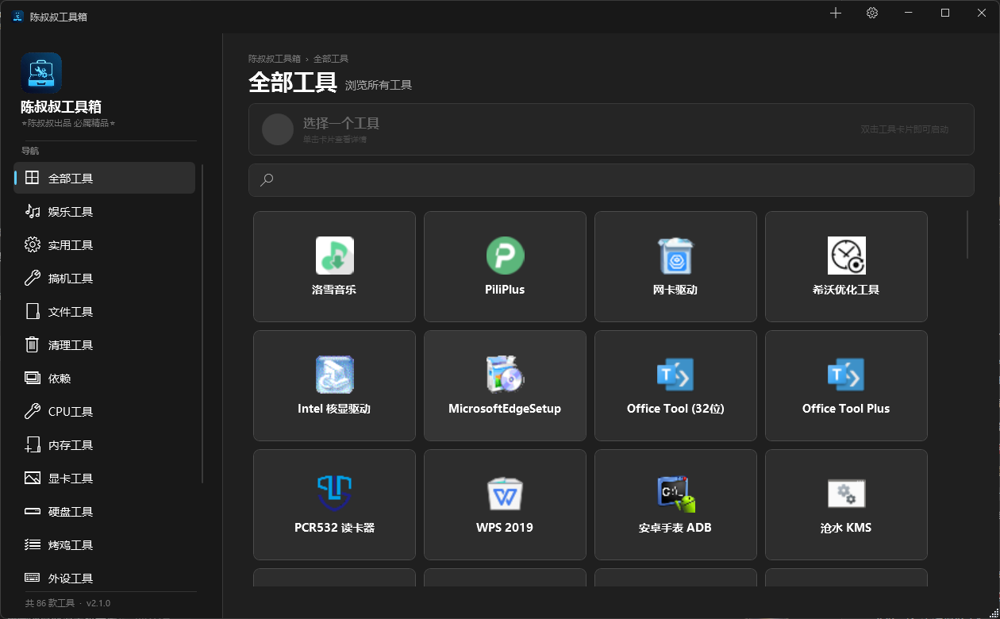

<div align="center">

# 🔧 陈叔叔工具箱

**一款面向电脑维修、系统调试、硬件检测的便携式工具集合**


</div>



## 📖 简介

陈叔叔工具箱把维修现场常用的检测、清理、装机工具收进一个窗口：**16 个分类、90 个工具条目**，双击即用。

**免安装、不写注册表**，整个目录拷到 U 盘就能带走。

## ✨ 功能特点

- 🚀 **便携免安装** —— 单文件自包含发布，目标机器不需要装 .NET
- 🎨 **统一暗色界面** —— Win11 风格自绘标题栏，弹窗与右键菜单同源同风格
- 🔍 **即时搜索** —— 按名称、描述、分类模糊匹配，输入即有结果
- 🔀 **拖拽排序 + 右键编辑** —— 常用工具拖到最前，显示名和描述随时改
- ✏️ **重命名分类** —— 右键分类改名，`工具\` 下的文件夹和所有工具路径一起跟着改
- 📥 **自动收录** —— 启动时发现 `工具\` 下未登记的条目，问一句要不要加进来
- 🧭 **路径自愈** —— 工具文件被挪到 `工具\` 下别处时，按「文件名 + 体积」自动找回，不用重加
- 🗑️ **可撤销的删除** —— 删除的工具进工具箱自带回收站，状态栏可直接撤销，设置里可恢复或清空
- 📦 **分类管理** —— 右键分类可重命名或删除，支持自定义分类与工具
- 🔄 **更新提示** —— 读取 GitHub Release，有新版本时弹出提示
- 💾 **配置自愈** —— `config.json` 缺失或损坏时，从程序内置模板重建；损坏的那份会先备份成 `.broken-时间戳`

## 🗂️ 工具分类

| 分类 | 数量 | 主要工具 |
|------|------|----------|
| 🎵 娱乐工具 | 3 | 酷我音乐、PiliPlus、洛雪音乐 |
| 💼 实用工具 | 9 | Edge 浏览器、Office Tool Plus、WPS 2019、网卡驱动 |
| 🔧 搞机工具 | 4 | HEU KMS、沧水 KMS、安卓手表 ADB、鲁大师 |
| 📁 文件工具 | 5 | 图压、磁盘精灵、迅雷、格式转换 |
| 🧹 清理工具 | 4 | HiBit Uninstaller、IObit、Geek、SoftCnKiller |
| 📚 依赖 | 4 | .NET Framework 4.7 / 4.7.2、VC++ 运行库 |
| 💻 CPU 工具 | 7 | CPU-Z、Core Temp、ThrottleStop、Prime95、LinX |
| 🧠 内存工具 | 6 | MemTest、Thaiphoon、TM5、ZenTimings |
| 🖥️ 显卡工具 | 7 | GPU-Z、DDU、nvidiaInspector、DXVAChecker |
| 💽 硬盘工具 | 11 | CrystalDiskInfo、CrystalDiskMark、WizTree、DiskGenius |
| 🔥 烤鸡工具 | 2 | FurMark、FurMark GUI |
| 🖱️ 外设工具 | 5 | 鼠标测试、键盘测试、KeyTweak、MouseTester |
| 🖵 显示器工具 | 3 | 色域检测、UFO 测试、在线屏幕测试 |
| 📊 综合检测 | 4 | AIDA64、HWiNFO、HWMonitor、Speccy |
| ⚙️ 系统工具 | 12 | Dism++、Everything、Rufus、Ventoy、Process Explorer |
| 🎮 游戏平台 | 4 | Steam、Epic、EA App、战网 |

> 程序会自动隐藏**文件不存在**的工具条目，所以界面显示的数量可能少于配置文件中的条目数。

## 📥 下载与使用

1. 从 [Releases](https://github.com/Foxelf-Studio/AngkleChen-ToolBox/releases) 下载压缩包，也可以直接用[夸克网盘](https://pan.quark.cn/s/19ab5a5b746a)
2. 解压到任意目录（U 盘、桌面均可）
3. 双击 `AngkleChenToolBox.exe`

### 系统要求

- Windows 10 1809 及以上 / Windows 11，x64
- 无需安装 .NET 运行时（已内置）

### 基本操作

| 操作 | 效果 |
|------|------|
| 单击卡片 | 在顶部显示工具描述 |
| 双击卡片 | 启动工具 |
| 拖动卡片 | 调整顺序（仅"单个分类 + 未搜索"时生效，会写回 config.json） |
| 右键卡片 | 打开 / 打开所在文件夹 / 复制路径 / 编辑名称与描述 / 删除 |
| 右键分类 | 重命名分类 / 删除分类（连同其下工具，进回收站） |
| 标题栏 `+` | 添加自定义工具 |
| 标题栏齿轮 | 设置：更新检查、日志开关、回收站 |
| 搜索框 | 按名称 / 描述 / 分类过滤 |

## 🔄 更新

程序会在启动后检查 GitHub Release。发现新版本时点击提示即可跳转下载。

**升级只需要替换 `AngkleChenToolBox.exe` 这一个文件**——工具目录、设置、图标缓存都不用动。关闭程序 → 覆盖 exe → 再打开，就完事了。

几个细节：

- 首次用新版打开时，程序会自动把旧版 `config.json` 升级成新格式（补上 `id` 和 `size` 字段），并留下一份 `config.json.bak`。这是程序自己写盘，不需要你操作
- 旧版配置不会被丢弃：所有分类、工具、自定义名称、排序、回收站内容都在
- 新版的配置也能被旧版读（多出来的字段会被忽略）。所以万一新版出问题，**把旧的 exe 换回来就能回滚**，不会因为配置已升级而卡住
- 整个程序是单文件自包含发布，目标机器不需要装 .NET；替换时如果提示文件被占用，先退出正在运行的程序

## 🛠️ 开发技术

- **框架**：.NET 10 + WPF
- **语言**：C# 14
- **界面**：Win11 风格自绘（WindowChrome + 自绘弹窗 / 右键菜单）
- **列表**：自研 `VirtualizingWrapPanel`，只渲染可视区域的卡片
- **配置**：`config.json` 单一数据源，编译时嵌入程序集作为重建模板
- **图标**：Windows Shell API 提取 + 本地 PNG 缓存（按源文件 mtime 自动刷新）
- **资源**：`Assets/logo.ico`（16–256 七个尺寸），运行时不加载原始 1 MB PNG

## 📁 项目结构

```
陈叔叔工具箱/
├── Controls/                       # 自定义控件
│   ├── ToolCard.xaml               # 工具卡片
│   ├── VirtualizingWrapPanel.cs    # 虚拟化卡片布局
│   ├── Win11ContextMenu.cs         # 自绘右键菜单（全局唯一实现）
│   ├── SettingsPanel.xaml          # 设置面板（含回收站）
│   ├── AddToolDialog.xaml          # 添加工具（含新建分类的图标选择）
│   ├── EditToolDialog.xaml         # 编辑工具名称与描述
│   ├── InputDialog.xaml            # 通用单行输入（重命名分类等）
│   ├── SelectExeDialog.xaml        # 多 exe 选择
│   ├── ProgressDialog.xaml         # 复制进度
│   ├── CustomMessageBox.xaml       # 统一风格消息框
│   └── UpdateDialog.xaml           # 更新详情
├── Services/                       # 业务逻辑（与窗口解耦）
│   ├── ToolLauncher.cs             # 启动 .exe / .bat / 目录
│   └── ToolImporter.cs             # 导入工具到 工具\
├── Helpers/                        # 基础设施
│   ├── AppPaths.cs                 # 程序目录与常用路径的唯一出口
│   ├── AppConfig.cs                # 配置 + 回收站（schema v2，含 id 迁移）
│   ├── ToolScanner.cs              # 扫描 工具\ 下未收录的条目
│   ├── IconHelper.cs               # 图标提取与缓存
│   ├── SmoothScrollBehavior.cs     # 惯性滚动
│   ├── UpdateChecker.cs            # GitHub Release 检查
│   ├── VersionInfo.cs              # 版本号统一出口
│   └── Logger.cs                   # 可选日志
├── Models/                         # ToolInfo / CatInfo
├── Assets/                         # 图标资源（多尺寸 ico + 缩略图）
├── docs/                           # UI 规范 + 截图
├── 工具/                           # 内置工具（不进仓库）
├── 回收站/                         # 删除的工具暂存（运行时生成）
├── config.json                     # 工具清单（唯一数据源）
├── settings.json                   # 用户设置
├── MainWindow.xaml(.cs)            # 主窗口
├── App.xaml(.cs)                   # 入口与全局样式
└── AngkleChenToolBox.csproj        # 项目文件（输出同名 exe）
```

## ⚙️ 配置说明

### config.json

```json
{
  "categories": [
    {
      "id": "7f3a91c4d0e2",
      "name": "CPU工具",
      "icon": "\ue90f",
      "description": "处理器检测与测试",
      "tools": [
        {
          "id": "b8e2c5a17f04",
          "name": "CPU-Z",
          "description": "处理器检测工具……",
          "relativePath": "工具\\CPU工具\\CPUZ\\cpuz_x64.exe",
          "order": 10
        }
      ]
    }
  ],
  "trash": []
}
```

- `id`：稳定标识，12 位十六进制。**由程序生成，不需要手填**——老配置首次启动会自动补齐
- `name`：显示名，随时可改，改了不影响任何关联
- `icon`：Segoe MDL2 Assets 字体码位
- `relativePath`：相对于程序目录的路径，文件在哪就写哪
- `order`：分类内排序权重，拖拽后自动写入（10、20、30…）；为 0 或缺失时按名称排
- `size`：文件体积（字节），程序自动记录。路径失效时靠它确认"这是同一个工具"，不要手改
- `trash`：回收站条目，由程序维护，不建议手动修改

> **为什么要有 `id`**：以前拿 `relativePath` 当主键，改个分类名就让该分类下所有路径失效。现在 `id` 是身份、`relativePath` 只是"文件此刻在哪"，重命名分类时程序会连目录一起改名并批量改写路径，`id` 全程不动。

### 文件被挪走了会怎样

如果你在资源管理器里把某个工具的文件或文件夹挪到了 `工具\` 下的别处，下次启动时程序会按 **文件名 + 体积** 在 `工具\` 里找回来，自动改配置，并在状态栏提示「已找回 N 个被移动过位置的工具」。

找回的规则很保守，宁可不修也不猜错：

- 同名同体积的候选**必须全局唯一**，有两个以上就放弃
- 同名但体积对不上（比如换成了新版本）不算同一个工具
- 不会把某个工具的地址让给另一个工具
- 不会认领别的工具目录内部的 exe（`unins000.exe`、内置的 `7z.exe` 这类）

### 添加自定义工具

点击标题栏 `+`，选择文件或文件夹 → 选择分类 → 填写名称，程序会复制到 `工具\<分类>\` 并写入配置。

把文件直接拷进 `工具\<分类>\` 也能被识别：下次启动时会提示"发现未收录的条目"，确认后自动加入清单。

## 🔧 构建

```bash
git clone https://github.com/Foxelf-Studio/AngkleChen-ToolBox.git
cd AngkleChen-ToolBox

# 调试运行
dotnet run

# 发布单文件便携版（约 137 MB，产物为 publish/AngkleChenToolBox.exe）
dotnet publish -c Release -r win-x64 --self-contained true -p:PublishSingleFile=true -o publish
```

推送 `v*` 标签时 GitHub Actions 会自动构建并附加到 Release，无需手动打包。

## 🤝 贡献

欢迎 Issue 和 PR。提交前请确认 `dotnet build` 零警告。

## ⚠️ 关于内置的第三方工具

官方分发的工具套件里包含若干第三方软件，其中 **HEU KMS Activator**、**沧水 KMS** 属于 Windows / Office 激活相关工具，不同于 CPU-Z、CrystalDiskInfo 这类硬件检测软件。

- 这些工具由第三方作者开发，本项目**仅做便携化整合**，不参与开发，也不对其行为负责
- 激活工具的使用可能违反相应软件的许可协议，**是否使用、如何使用，请自行判断并承担相应责任**
- 部分工具（尤其是激活、驱动、清理类）**可能被杀毒软件拦截或报毒**。误报与真实风险并存，请先自行核实来源与文件哈希，再决定是否运行
- 出于安全考虑，**不建议长期关闭杀毒软件使用**；如确实需要临时放行，请在用完后立即恢复防护

> 如果你只需要硬件检测、系统维护类工具，可以右键删除 `搞机工具` 分类（会进入回收站，可恢复），把这一部分从自己的清单里摘掉。

## 📄 许可证

[MIT](LICENSE)

## 🙏 致谢

感谢 [CPU-Z](https://www.cpuid.com/softwares/cpu-z.html)、[GPU-Z](https://www.techpowerup.com/gpuz/)、[CrystalDiskInfo](https://crystalmark.info/)、[Dism++](https://www.chuyu.me/)、[Everything](https://www.voidtools.com/)、[FurMark](https://www.geeks3d.com/furmark/)、[AIDA64](https://www.aida64.com/) 等工具的作者。

> 内置工具的版权归各自作者所有，本项目仅做便携化整合。

## 📮 联系方式

- GitHub：[Foxelf-Studio/AngkleChen-ToolBox](https://github.com/Foxelf-Studio/AngkleChen-ToolBox)
- Issues：[提交问题](https://github.com/Foxelf-Studio/AngkleChen-ToolBox/issues)
- 邮箱：SeenyDafa@gmail.com
